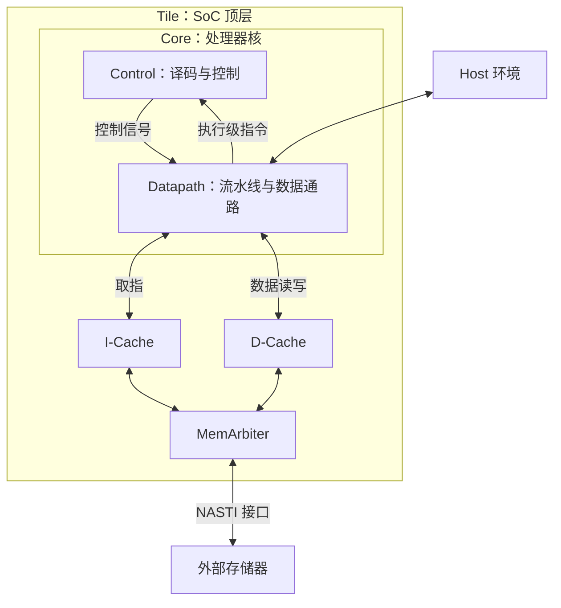
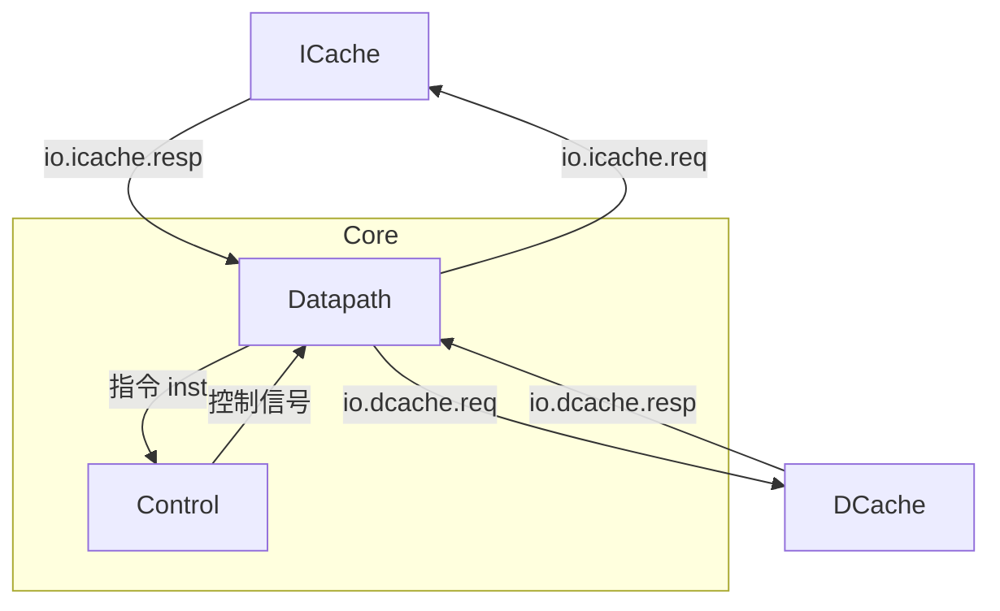
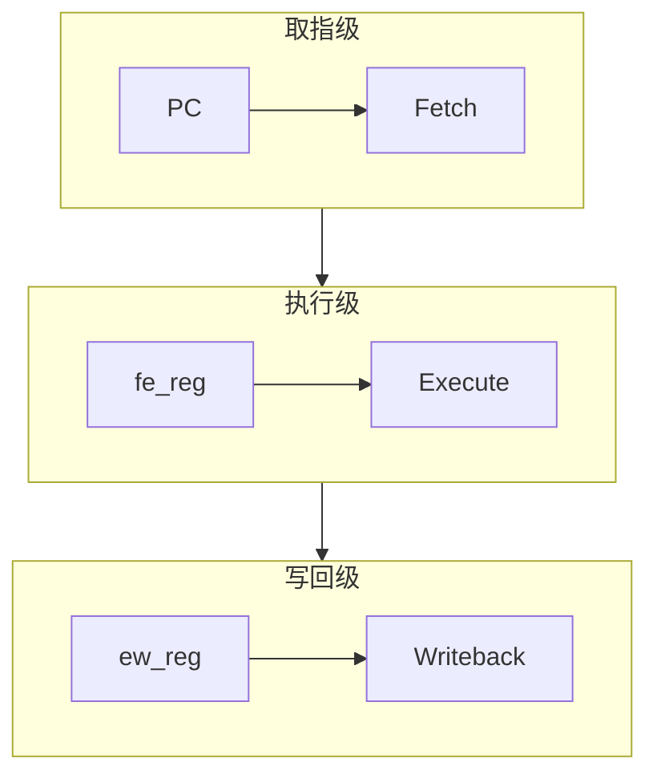
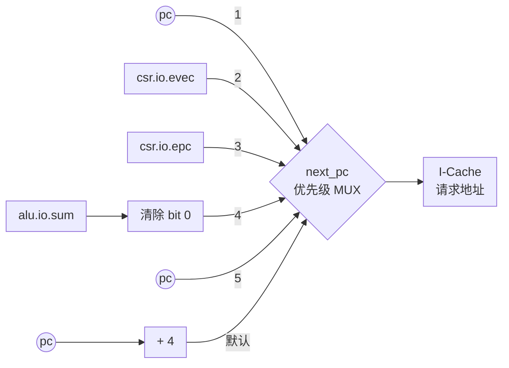
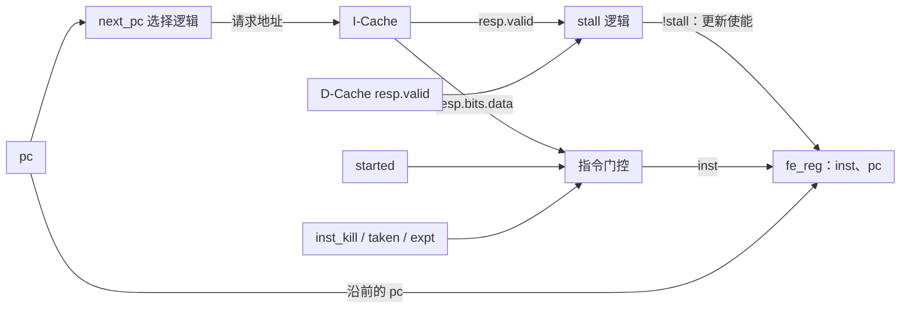

# riscv-mini 处理器微架构

## 第一章 整体结构

riscv-mini 是一个 **32 位、单发射、顺序执行的三级流水处理器**，实现了 RV32I 基础整数指令，并包含 CSR 和异常处理相关逻辑。核外有独立的指令缓存和数据缓存，两者共享一个外部存储器接口。

### 1.1 SoC 实例化结构

`Core` 负责执行指令，`Tile` 将 Core、两路 Cache 和访存仲裁器组合成完整的顶层模块。



程序中的指令和数据最终都存放在外部存储器中。执行时，Core 通过 I-Cache 取得指令，通过 D-Cache 读写程序数据。两路 Cache 命中时，可以直接向核心提供服务；需要从外部装入缓存行或写回脏数据时，再通过 `MemArbiter` 使用外部总线。

顶层的 `nasti` 是带有读地址、读数据、写地址、写数据、写响应通道的接口；`host` 则连接核心中的 CSR 逻辑，提供 `fromhost` 和 `tohost`，供处理器与外部运行环境交换信息。

### 1.2 Core 实例化结构

`Core` 内部主要实例化两个模块：

- `Control`：对执行级的指令进行译码，生成控制信号，是组合译码逻辑。
    - 例如执行 `addi x3, x1, 8` 决定“第一个操作数选寄存器、第二个操作数选立即数、ALU 做加法、结果写回”。
- `Datapath`：根据控制信号选择操作数、完成计算、访问缓存并更新状态，流水寄存器、缓存等待造成的停顿、下一条 PC 的选择等均在这里实现。
    - 例如执行 `addi x3, x1, 8` 读取 `x1`、生成立即数 `8`、计算和，并最终写入 `x3`。

二者通过 `io` 端口连接。Core 包含 Control 和 Datapath，ICache 和 DCache 位于 Core 外部；箭头表示指令、控制信号与缓存请求和响应的方向：



展开这两个模块得到下面的实例层次：

```text
Core
├── ctrl：Control
│   └── 组合译码逻辑：ListLookup + 指令控制表
└── dpath：Datapath
    ├── csr：CSR
    ├── regFile：RegFile
    ├── alu：AluArea
    ├── immGen：ImmGenWire
    └── brCond：BrCondArea
```

`Control` 内部没有子模块，而是用 `ListLookup(io.inst, Control.default, Control.map)` 将输入指令与译码表匹配，再把匹配结果分配给各个控制输出。

`Datapath` 实例化了五个子模块：

```scala
val csr = Module(new CSR(conf.xlen))
val regFile = Module(new RegFile(conf.xlen))
val alu = Module(conf.makeAlu(conf.xlen))
val immGen = Module(conf.makeImmGen(conf.xlen))
val brCond = Module(conf.makeBrCond(conf.xlen))
```

两路缓存通过 Core 的 `io.icache`、`io.dcache` 接口连接到 Datapath。

## 第二章 三级流水线

### 2.1 流水线整体结构



- **pc**：保存取指地址。下一地址通常按顺序加 4，也可以由分支、跳转或异常处理逻辑选择；流水线停顿时保持不变。PC 是 Datapath 内部的寄存器，属于取指逻辑，图中单独画出以突出地址来源。
- **Fetch**：访问 I-Cache，并选择后续取指地址。取得的指令及其 PC 通过 `fe_reg` 进入执行级。
- **Execute**：完成译码、寄存器读取、立即数生成和 ALU 运算，同时判断分支条件、发起数据访存请求。运算结果及相关信息通过 `ew_reg` 进入写回级。
- **Writeback**：处理 load 返回数据、访问 CSR 并处理异常，根据写回选择信号确定最终结果，在允许写回时更新目的寄存器。

| 流水寄存器 | 驱动级别  | 保存的主要信息 |
| ---------- | --------- | --- |
| `pc`       | Fetch     | 指令地址 |
| `fe_reg`   | Execute   | 指令 `inst` 及其地址 `pc` |
| `ew_reg`   | Writeback | 指令、PC、ALU 结果、CSR 输入数据 |

此外，访存类型、写回选择、写回使能、CSR 命令等控制信息，也由寄存器保存并随指令进入写回级。

以连续三条普通指令为例，假定缓存命中、没有冲刷和停顿，可以形成下面的重叠关系。

| 周期 | Fetch | Execute | Writeback |
| --- | --- | --- | --- |
| 1 | 指令 A | — | — |
| 2 | 指令 B | 指令 A | — |
| 3 | 指令 C | 指令 B | 指令 A |
| 4 | 指令 D | 指令 C | 指令 B |

### 2.2 PC 的更新

**初始化**

PC 的初始化由下面这条语句完成：

```scala
val pc = RegInit(Consts.PC_START.U(conf.xlen.W) - 4.U(conf.xlen.W))
```

当前配置中 `PC_START = 0x200`，所以复位 `pc` 为 `pc = 0x200 - 4 = 0x1FC`，这是因为使用的是 `next_pc`，这样处理器核才能把 `0x200` 发送给 I-Cache，因此 `0x200` 才是程序入口地址。

**PC 取值来源**



**下一地址的选择优先级**

`next_pc` 有以下五种可能取值。下表按选择优先级排列。多个条件同时成立时，以优先级较高者为准。`pc` 可由两种不同条件选中。

| P | 取值 | 选择条件 | 流水级 | 作用 |
| - | ---- | -------- | ------ | ---- |
| 1 | `pc` | `stall` | 全局 | Cache 等待期间保持 |
| 2 | `csr.io.evec` | `csr.io.expt` 拉高 | 写回级 | 转到异常入口 |
| 3 | `csr.io.epc` | `io.ctrl.pc_sel === PC_EPC` | 执行级 | 返回异常前保存的地址 |
| 4 | `alu.io.sum 清空最低位` | `io.ctrl.pc_sel === PC_ALU` 或 `brCond.io.taken` | 执行级 | 跳转或条件分支目标，清除最低位 |
| 5 | `pc` | `io.ctrl.pc_sel === PC_0` | 执行级 | 按指令控制要求保持 |
| 默认 | `pc + 4` | 以上条件均不成立 | 取指级 | 顺序取下一条指令 |

- **顺序执行**：普通算术指令和未成立的条件分支通常走这条路径。
- **条件分支**：`BrCond` 是比较源寄存器，输出 `brCond.io.taken`，分支成立时，ALU 传入执行级的 `fe_reg.pc` 和立即数，输出目标地址，并把已经取到的错误指令替换为 `NOP`。
- **无条件跳转**：`JAL` 的目标为 `fe_reg.pc + 立即数`，`JALR` 的目标为 `R[rs1] + 立即数`，`R[rs1]` 也可能来自旁路。
- **分支默认预测**：当分支不成立或为无条件跳转的指令时，仍继续连续取指令，因此这里是默认预测分支不跳转。
- **异常与返回**：异常信号来自写回级的 CSR，优先级高于较年轻的执行级指令所发起的跳转。`PC_EPC` 由当前实现的 `ERET` 指令选择，返回目标来自 `mepc`。
- **主动保持地址**：`PC_0` 的含义是“地址增量为零”，即保持 `pc`，主要是供 load、CSR 指令和 `FENCEI` 使用，同时配合插入 NOP。
- **`stall` 和 `PC_0`的区别**：`stall` 时取指请求拉低，`fe_reg` 保持，等待 Cache，不能继续正常推进。选择 `PC_0` 时虽然 PC 保持，但取指请求仍然有效，流水寄存器可以推进，然后替换指令为 NOP。

### 2.3 取指逻辑

取指级负责把下一条指令的地址送给 I-Cache，并把返回的指令和当前地址一起送入执行级。



取指请求的地址使用 `next_pc`，这说明 I-Cache 的请求地址可能是顺序地址 `pc + 4`。

取指只读，因此写数据置零，字节写掩码也置零以表示读操作；取指请求的 `abort` 固定为假。

`stall` 则是指 I-Cache 和 D-Cache 都没有响应。

```scala
val stall = !io.icache.resp.valid || !io.dcache.resp.valid
io.icache.req.bits.addr := next_pc
io.icache.req.bits.data := 0.U
io.icache.req.bits.mask := 0.U
io.icache.req.valid := !stall
io.icache.abort := false.B
```

I-Cache 返回的数据不会无条件进入流水线，而是先经过 `inst` 的组合选择：

```scala
val inst = Mux(
  started || io.ctrl.inst_kill || brCond.io.taken || csr.io.expt,
  Instructions.NOP,
  io.icache.resp.bits.data
)
```

只要以下任一条件成立，当前取指结果就改成 `NOP`：

- `started`：复位刚释放后的启动周期 | 避免把启动阶段尚未对应到有效请求的数据当作第一条指令 |
| `io.ctrl.inst_kill` | 当前执行级指令要求插入气泡，例如跳转、load、CSR 指令、`FENCEI` 或 `ERET` | 跳转时丢弃顺序路径指令；保持 PC 时插入气泡，为当前操作留出处理时间 |
| `brCond.io.taken` | 执行级条件分支成立 | 分支目标已经改写 `next_pc`，顺序路径上的返回指令需要丢弃 |
| `csr.io.expt` | 写回级检测到异常 | 异常入口优先，年轻指令不能越过异常继续执行 |

这里的 `NOP` 是一种流水线气泡，不会改变程序可见的寄存器或存储器状态。`inst` 的选择是组合逻辑；若同时发生停顿，即使 `inst` 已变成 `NOP`，也要等允许推进时才会写入 `fe_reg`。

**`started` 与启动周期**

```scala
val started = RegNext(reset.asBool)
```

`started` 保存上一拍的复位信号。因此复位刚释放时，它仍为真；下一个时钟沿采样到复位为假后，它才变为假。这个信号不参与 PC 选择，只在启动周期把 `inst` 替换为 `NOP`。

复位释放后，`pc = 0x1FC`，在允许推进且没有重定向时，`next_pc = 0x200`。虽然此时送出的请求地址正确，但 I-Cache 使用同步读存储器，当前返回的数据并不立即对应刚送出的 `0x200`。此外，Cache 处于空闲状态时也会令 `resp.valid` 为真，所以启动时不能只靠 `stall` 排除无效返回值。`started` 正是用来屏蔽这一拍的返回数据。

在首个允许推进的启动沿，PC 更新为 `0x200`，`fe_reg.inst` 写入 `NOP`。此后如果入口取指未命中，Cache 会通过响应有效位使核心停顿；入口指令准备好后，才会与 `pc = 0x200` 一起进入执行级。`started` 只负责启动这一拍，不会一直等待首次 Cache 响应。

**写入取指—执行流水寄存器**

当没有停顿时，取指级把当前 `pc` 和经过门控的 `inst` 写入 `fe_reg`：

```scala
when(!stall) {
  fe_reg.pc := pc
  fe_reg.inst := inst
}
```

这里有一个容易混淆的时序关系：同一个时钟沿还会执行 `pc := next_pc`，但 `fe_reg.pc := pc` 读取的是时钟沿到来前的旧 `pc`。所以 `fe_reg` 保存的是**当前返回指令对应的地址**，而 I-Cache 请求使用的是**下一次取指地址 `next_pc`**。

忽略启动气泡，假定缓存连续命中、没有停顿或冲刷，可以用连续顺序取指表示这个关系：

| 时钟沿前 `pc` | 本周期 I-Cache 请求 `next_pc` | 写入 `fe_reg.pc` | 写入 `fe_reg.inst` |
| --- | --- | --- | --- |
| `0x200` | `0x204` | `0x200` | `0x200` 处返回的指令 |
| `0x204` | `0x208` | `0x204` | `0x204` 处返回的指令 |
| `0x208` | `0x20C` | `0x208` | `0x208` 处返回的指令 |

当 `stall` 为真时，`io.icache.req.valid` 为假，`fe_reg` 也不更新，`pc` 通过 `next_pc = pc` 保持不变。等缓存响应重新有效后，取指级才恢复推进。

**分支或跳转发生时的取指顺序**

分支和跳转的目标地址由执行级产生，而取指级已经可能沿顺序路径发起了下一次请求。因此处理过程分为两步：

1. 执行级通过 `brCond.io.taken` 或 `io.ctrl.pc_sel === PC_ALU` 让 `next_pc` 改为目标地址。
2. 在允许推进时，取指级当周期就把目标地址送给 I-Cache，同时用 `brCond.io.taken` 或 `io.ctrl.inst_kill` 把当前顺序路径的返回值改为 `NOP`。目标指令在之后准备好并允许推进时才进入执行级。

这不是带有 BTB 或历史表的动态分支预测器；普通取指只是沿 `pc + 4` 的顺序路径继续请求，等执行级确认跳转后再重定向并冲刷错误路径。`fe_reg` 因此既可能接收正常指令，也可能接收用于清空错误路径的 `NOP`。

### 2.4 执行逻辑

### 2.5 写回逻辑

### 2.6 流水寄存器

## 第三章 数据通路组件

### 3.1 xxx

### 3.2 xxx

### 3.3 xxx

### 3.4 xxx

## 第四章 缓存系统

### 4.1 Cache 的基本结构

`Tile` 分别实例化一个 I-Cache 和一个 D-Cache，两者使用同一个 `Cache` 模块、各自保存独立的缓存内容。面向 Core 的一侧是 `CacheIO`，面向外部存储器的一侧是 NASTI 总线；两路缓存的 NASTI 请求经 `MemArbiter` 汇合。取指请求只读 I-Cache，数据访存请求读写 D-Cache。

当前 `MiniConfig` 为每路 Cache 设置 `nSets = 256`、`blockBytes = 16`、`nWays = 1`。实现中每个组只有一份标签和一条数据行，没有按路选择或替换逻辑，因此是**直接映射缓存**；`nWays` 尚未参与硬件实现，单独修改它不会得到多路组相联结构。每条缓存行含 4 个 32 位字，数据容量为 `256 × 16 B = 4 KiB`（不含标签、有效位和脏位）。外部 NASTI 数据宽度为 64 位，装入或写回一行需要传输 2 个数据拍。

| 32 位地址字段 | 位范围 | 用途 |
| --- | --- | --- |
| Tag | `[31:12]`，20 位 | 与组内保存的标签比较 |
| 组索引 | `[11:4]`，8 位 | 选择 256 个组之一 |
| 行内字偏移 | `[3:2]`，2 位 | 选择缓存行中的一个 32 位字 |
| 字节偏移 | `[1:0]`，2 位 | 配合写掩码定位字内字节 |

缓存的数据与状态分别存放：`metaMem` 是每组一个 Tag 的同步读存储器；`dataMem` 由 4 个按字组织的同步读存储器组成，每个字又拆为 4 个可按字节掩码写入的字节。`v` 和 `d` 是按组索引的有效位、脏位寄存器向量。只有 `v` 有效且读出的 Tag 与请求 Tag 相等才算命中。由于标签和数据采用同步读，请求先按组索引发起读，下一拍再使用读出结果完成比较和 32 位字选择；`addr_reg`、`cpu_data`、`cpu_mask` 保存处理中的请求信息，`rdata_buf` 保存需要跨周期使用的读出数据，`refill_buf` 暂存从外部存储器返回的整行。


Core 请求包含 32 位地址、32 位写数据和 4 位字节写掩码：掩码全零表示读，非零表示写；响应包含 32 位数据和 `valid`，接口没有 `ready` 信号。命中时从所选字返回读数据，或按掩码更新对应字节并置脏；缺失时，若被映射组中的旧行有效且为脏行，就先写回旧行，再装入新行，否则直接装入。装入时写入新 Tag 和整行数据、置有效并清脏；写缺失随后更新新行，因此采用**写分配、写回**策略。状态机用 `sIdle`、`sReadCache`、`sWriteCache`、`sWriteBack`、`sWriteAck`、`sRefillReady`、`sRefill` 协调这些过程。需要注意，`sIdle` 时 `resp.valid` 本身就为真，不能将它单独解释为一次新请求已经命中；取指级的启动屏蔽逻辑正是为这一时序特性服务。


