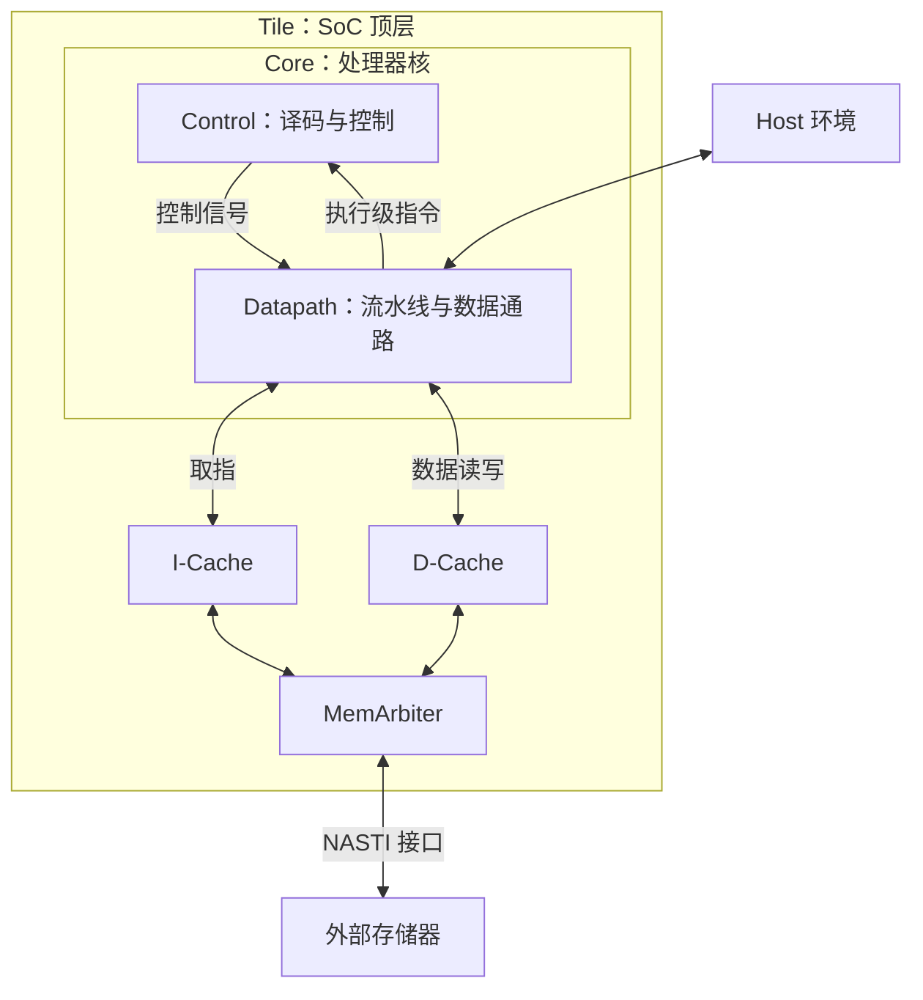
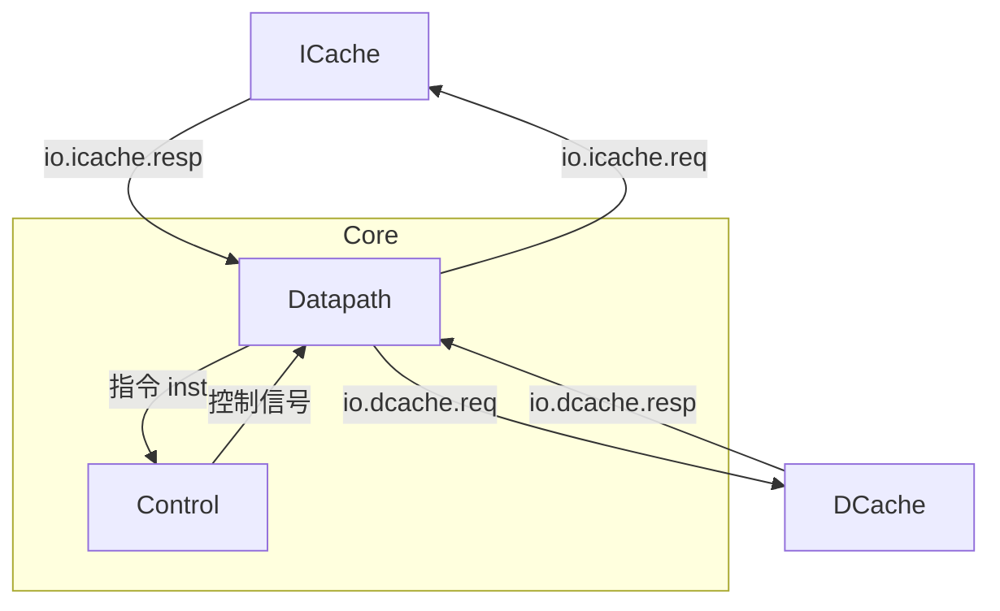
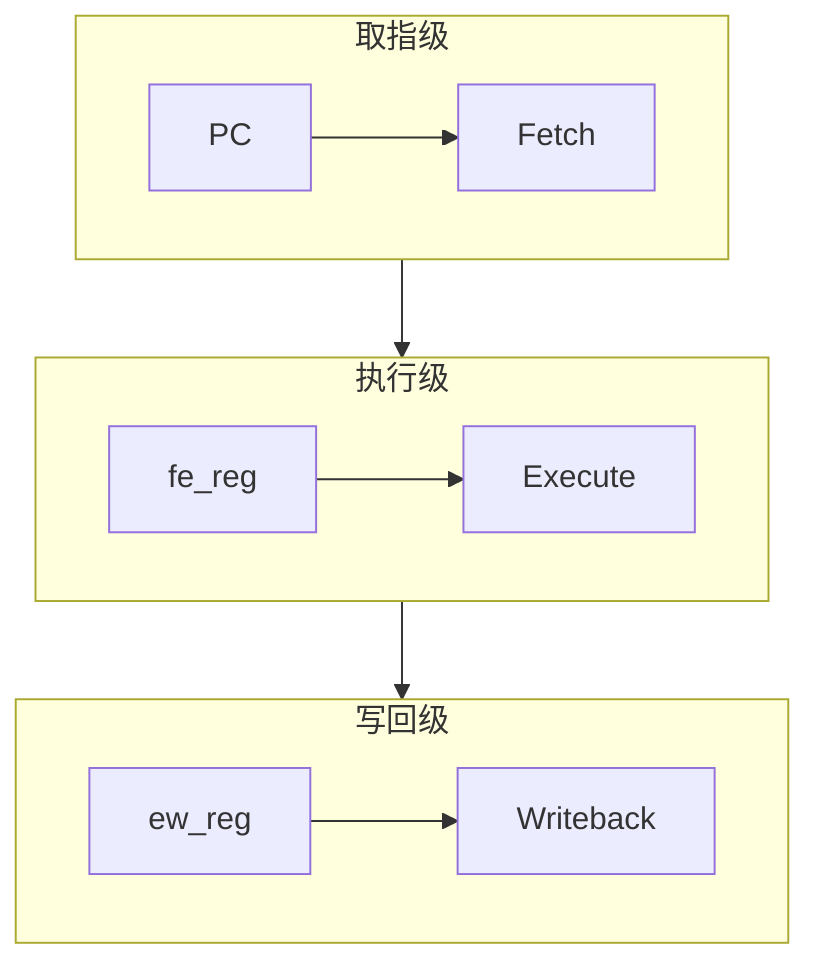
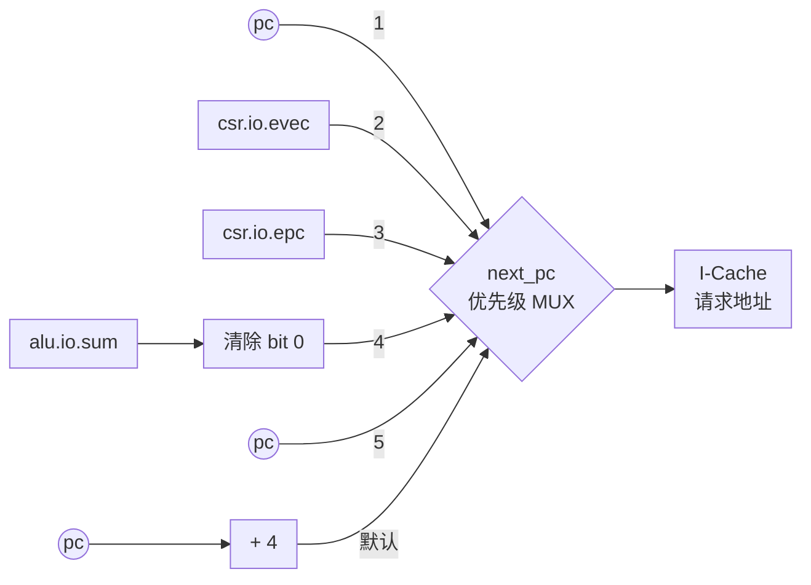

# riscv-mini 处理器微架构

## 第一章 整体结构

riscv-mini 是一个 **32 位、单发射、顺序执行的三级流水处理器**，实现了 RV32I 基础整数指令，并包含 CSR 和异常处理相关逻辑。核外有独立的指令缓存和数据缓存，两者共享一个外部存储器接口。

### 1.1 SoC 实例化结构

`Core` 负责执行指令，`Tile` 将 Core、两路 Cache 和访存仲裁器组合成完整的顶层模块。



程序中的指令和数据最终都存放在外部存储器中。执行时，Core 通过 I-Cache 取得指令，通过 D-Cache 读写程序数据。两路 Cache 命中时，可以直接向核心提供服务；需要从外部装入缓存行或写回脏数据时，再通过 `MemArbiter` 使用外部总线。

顶层的 `nasti` 是带有读地址、读数据、写地址、写数据、写响应通道的接口；`host` 则连接核心中的 CSR 逻辑，提供 `fromhost` 和 `tohost`，供处理器与外部运行环境交换信息。

### 1.2 Core 实例化结构

`Core` 内部主要实例化两个模块：

- `Control`：对执行级的指令进行译码，生成控制信号，是组合译码逻辑。
    - 例如执行 `addi x3, x1, 8` 决定“第一个操作数选寄存器、第二个操作数选立即数、ALU 做加法、结果写回”。
- `Datapath`：根据控制信号选择操作数、完成计算、访问缓存并更新状态，流水寄存器、缓存等待造成的停顿、下一条 PC 的选择等均在这里实现。
    - 例如执行 `addi x3, x1, 8` 读取 `x1`、生成立即数 `8`、计算和，并最终写入 `x3`。

二者通过 `io` 端口连接。Core 包含 Control 和 Datapath，ICache 和 DCache 位于 Core 外部；箭头表示指令、控制信号与缓存请求和响应的方向：



展开这两个模块得到下面的实例层次：

```text
Core
├── ctrl：Control
│   └── 组合译码逻辑：ListLookup + 指令控制表
└── dpath：Datapath
    ├── csr：CSR
    ├── regFile：RegFile
    ├── alu：AluArea
    ├── immGen：ImmGenWire
    └── brCond：BrCondArea
```

`Control` 内部没有子模块，而是用 `ListLookup(io.inst, Control.default, Control.map)` 将输入指令与译码表匹配，再把匹配结果分配给各个控制输出。

`Datapath` 实例化了五个子模块：

```scala
val csr = Module(new CSR(conf.xlen))
val regFile = Module(new RegFile(conf.xlen))
val alu = Module(conf.makeAlu(conf.xlen))
val immGen = Module(conf.makeImmGen(conf.xlen))
val brCond = Module(conf.makeBrCond(conf.xlen))
```

两路缓存通过 Core 的 `io.icache`、`io.dcache` 接口连接到 Datapath。

## 第二章 三级流水线

### 2.1 流水线整体结构



- **pc**：保存取指地址。下一地址通常按顺序加 4，也可以由分支、跳转或异常处理逻辑选择；流水线停顿时保持不变。PC 是 Datapath 内部的寄存器，属于取指逻辑，图中单独画出以突出地址来源。
- **Fetch**：访问 I-Cache，并选择后续取指地址。取得的指令及其 PC 通过 `fe_reg` 进入执行级。
- **Execute**：完成译码、寄存器读取、立即数生成和 ALU 运算，同时判断分支条件、发起数据访存请求。运算结果及相关信息通过 `ew_reg` 进入写回级。
- **Writeback**：处理 load 返回数据、访问 CSR 并处理异常，根据写回选择信号确定最终结果，在允许写回时更新目的寄存器。

| 流水寄存器 | 驱动级别  | 保存的主要信息 |
| ---------- | --------- | --- |
| `pc`       | Fetch     | 指令地址 |
| `fe_reg`   | Execute   | 指令 `inst` 及其地址 `pc` |
| `ew_reg`   | Writeback | 指令、PC、ALU 结果、CSR 输入数据 |

此外，访存类型、写回选择、写回使能、CSR 命令等控制信息，也由寄存器保存并随指令进入写回级。

以连续三条普通指令为例，假定缓存命中、没有冲刷和停顿，可以形成下面的重叠关系。

| 周期 | Fetch | Execute | Writeback |
| --- | --- | --- | --- |
| 1 | 指令 A | — | — |
| 2 | 指令 B | 指令 A | — |
| 3 | 指令 C | 指令 B | 指令 A |
| 4 | 指令 D | 指令 C | 指令 B |

### 2.2 PC 的更新

**初始化**

PC 的初始化由下面这条语句完成：

```scala
val pc = RegInit(Consts.PC_START.U(conf.xlen.W) - 4.U(conf.xlen.W))
```

当前配置中 `PC_START = 0x200`，所以复位 `pc` 为 `pc = 0x200 - 4 = 0x1FC`，这是因为使用的是 `next_pc`，这样处理器核才能把 `0x200` 发送给 I-Cache，因此 `0x200` 才是程序入口地址。

**PC 取值来源**



**下一地址的选择优先级**

`next_pc` 有以下五种可能取值。下表按选择优先级排列。多个条件同时成立时，以优先级较高者为准。`pc` 可由两种不同条件选中。

| P | 取值 | 选择条件 | 流水级 | 作用 |
| - | ---- | -------- | ------ | ---- |
| 1 | `pc` | `stall` | 全局 | Cache 等待期间保持 |
| 2 | `csr.io.evec` | `csr.io.expt` 拉高 | 写回级 | 转到异常入口 |
| 3 | `csr.io.epc` | `io.ctrl.pc_sel === PC_EPC` | 执行级 | 返回异常前保存的地址 |
| 4 | `alu.io.sum 清空最低位` | `io.ctrl.pc_sel === PC_ALU` 或 `brCond.io.taken` | 执行级 | 跳转或条件分支目标，清除最低位 |
| 5 | `pc` | `io.ctrl.pc_sel === PC_0` | 执行级 | 按指令控制要求保持 |
| 默认 | `pc + 4` | 以上条件均不成立 | 取指级 | 顺序取下一条指令 |

- **顺序执行**：普通算术指令和未成立的条件分支通常走这条路径。
- **条件分支**：`BrCond` 是比较源寄存器，输出 `brCond.io.taken`，分支成立时，ALU 传入执行级的 `fe_reg.pc` 和立即数，输出目标地址，并把已经取到的错误指令替换为 `NOP`。
- **无条件跳转**：`JAL` 的目标为 `fe_reg.pc + 立即数`，`JALR` 的目标为 `R[rs1] + 立即数`，`R[rs1]` 也可能来自旁路。
- **分支默认预测**：当分支不成立或为无条件跳转的指令时，仍继续连续取指令，因此这里是默认预测分支不跳转。
- **异常与返回**：异常信号来自写回级的 CSR，优先级高于较年轻的执行级指令所发起的跳转。`PC_EPC` 由当前实现的 `ERET` 指令选择，返回目标来自 `mepc`。
- **主动保持地址**：`PC_0` 的含义是“地址增量为零”，即保持 `pc`，主要是供 load、CSR 指令和 `FENCEI` 使用，同时配合插入 NOP。
- **`stall` 和 `PC_0`的区别**：`stall` 时取指请求拉低，`fe_reg` 保持，等待 Cache，不能继续正常推进。选择 `PC_0` 时虽然 PC 保持，但取指请求仍然有效，流水寄存器可以推进，然后替换指令为 NOP。

### 2.3 取指级逻辑

取指级负责把下一条指令的地址送给 I-Cache，并把返回的指令和当前地址一起送入执行级。

取指请求的地址使用 `next_pc`，这说明在正常顺序取值的情况下，I-Cache 的请求地址是 `pc + 4`。

**`started` 与启动周期**

```scala
val started = RegNext(reset.asBool)
```

`started` 保存上一拍的复位信号。因此复位刚刚异步释放时，它仍为真，直到下一个时钟沿采样到复位为 0 后才变为 0。这个信号用于在启动周期把 `inst` 替换为 `NOP`，防止把复位刚刚释放那一刻的错误指令送入流水线。

**I-Cache 访问与取指门控**

取指只读，因此 I-Cache 的写数据置零，字节写掩码也置零以表示读操作；取指请求的 `abort` 固定为假。`stall` 指 I-Cache 和 D-Cache 都没有响应。

```scala
val stall = !io.icache.resp.valid || !io.dcache.resp.valid
io.icache.req.bits.addr := next_pc
io.icache.req.bits.data := 0.U
io.icache.req.bits.mask := 0.U
io.icache.req.valid := !stall
io.icache.abort := false.B
```

I-Cache 返回的数据先经过取指门控的选择才进入流水线。当以下任一条件成立，传入流水线的指令改为 `NOP`：

- `started`：复位刚释放后的启动周期，避免把启动阶段尚未对应到有效请求的数据当作第一条指令

- `io.ctrl.inst_kill`：执行级指令要求暂停流水线，在此处插入气泡，例如跳转、load、CSR 指令、`FENCEI` 或 `ERET`

- `brCond.io.taken`：执行级条件分支成立，原顺序路径上取回的指令需要丢弃

- `csr.io.expt`：写回级检测到异常，异常入口优先

**写入取指-执行流水寄存器**

当没有停顿时，取指级把 `pc` 和经过门控的 `inst` 写入 `fe_reg`：

这里有一个容易混淆的时序关系：同一个时钟沿还会执行 `pc := next_pc`，这里 `fe_reg.pc := pc` 使用的是旧 `pc`。所以 `fe_reg` 是当前返回指令对应的地址，而 I-Cache 请求使用的是下一次取指地址 `next_pc`。

假定流水线连续且没有气泡，可以用连续顺序取指表示这个关系：

| `pc` | `next_pc` | 即将写入 `fe_reg.pc` | 即将写入 `fe_reg.inst` |
| ------- | ------- | ------- | -------------------- |
| `0x200` | `0x204` | `0x200` | `0x200` 处返回的指令 |
| `0x204` | `0x208` | `0x204` | `0x204` 处返回的指令 |
| `0x208` | `0x20C` | `0x208` | `0x208` 处返回的指令 |

**分支或跳转发生时的取指顺序**

分支和跳转的目标地址由执行级产生，而取指级已经可能沿顺序路径发起了下一次请求。因此处理过程分为两步：

1. 执行级让 `next_pc` 选择分支或跳转的目标地址。
2. 取指级把当前返回的指令改为 `NOP`。

### 2.4 执行级逻辑

执行级以流水寄存器 `fe_reg.inst` 和 `fe_reg.pc` 为输入。指令送到 `Control` 译码，`Datapath` 则依照控制信号读操作数完成运算，并把结果交给写回级。

**生成立即数和读取操作数**：`ImmGen` 生成对应指令类型的立即数，指令的 `rs1`、`rs2` 传入 `RegFile` 的两个读端口，若上一条指令的写入寄存器序号与当前源寄存器的序号相同，执行级会直接从写回级别的 `ew_reg.alu` 寄存器旁路该结果，避免读到尚未写回的旧值。

**ALU 输入输出**：ALU 左操作数在 `rs1` 与 `fe_reg.pc` 间选择，ALU 右操作数在 `rs2` 与立即数间选择，`alu_op` 是 ALU 的运算类型选择符，运算结果则从 `alu.io.out` 输出。

**数据访存请求**：对 load 和 store，执行级从 `alu.io.sum` 将计算出来的有效地址传入 D-Cache。store 指令将会根据 `SB`、`SH`、`SW` 分别生成相应掩码，load 设置掩码为零。

**写入执行-写回流水寄存器**：没有 `stall` 和异常时，则将当前指令、PC、`alu.io.out` 以及 CSR 输入值保存到 `ew_reg`，一些控制信号也同步锁存。

### 2.5 写回级逻辑

写回级使用 `ew_reg` 保存的指令、PC、ALU 结果和 CSR 输入值，以及锁存的控制信号，决定是否更新通用寄存器和 CSR。

**选择写回数据**

写回 `regWrite` 的数据在 `ew_reg.alu`、D-Cache 返回数据、`ew_reg.pc + 4` 和 `csr.io.out` 中选择。

对 load，D-Cache 返回对齐的 32 位数据字；写回级根据 `ew_reg.alu` 的低两位右移，取出目标字节或半字。`LB`、`LH` 做符号扩展，`LBU`、`LHU` 做零扩展，`LW` 使用整个数据字。`ld_type` 随执行级指令一起锁存，保证使用正确的载入类型。

**提交与异常**

目的寄存器编号取自 `ew_reg.inst(11, 7)`。只有 `wb_en && !stall && !csr.io.expt` 成立时，`RegFile` 才写入 `regWrite`。store、分支等不需要通用寄存器结果的指令，其 `wb_en` 为假。`stall` 使 `ew_reg` 和写回控制信息保持不变，并阻止 CSR 指令写入与异常状态更新。

CSR 同时检查非法指令、权限、地址对齐及 `ECALL`/`EBREAK` 等异常条件；发生异常时，通用寄存器写回被抑制，D-Cache 收到 `abort`，待流水线可推进时 PC 转向 `csr.io.evec`。

## 第三章 数据通路组件

### 3.1 立即数生成器

### 3.2 通用寄存器文件

### 3.3 算术逻辑单元

本仓库中有 2 个待选择的 ALU 元件：`AluSimple` 和 `AluArea`。

- `CoreConfig` 用 `makeAlu: Int => Alu` 指定 ALU 的构造方式，默认值是 `new AluSimple(_)`。

- 本项目的 `MiniConfig` 将 `xlen` 设为 32，并把 `makeAlu` 显式改为 `new AluArea(_)`；`Datapath` 再通过 `Module(conf.makeAlu(conf.xlen))` 实例化。

输入 `width` 位的 `A`、`B` 和 4 位的 `alu_op`，输出为 `width` 位的 `out`、`sum`，内部为组合逻辑。

| 操作码 | 名称 | 运算内容 |
| ------ | ---- | -------- |
| `ALU_ADD` (`0000`) | 加法 | `A + B` |
| `ALU_SUB` (`0001`) | 减法 | `A - B` |
| `ALU_AND` (`0010`) | 按位与 | `A & B` |
| `ALU_OR` (`0011`) | 按位或 | `A \| B` |
| `ALU_XOR` (`0100`) | 按位异或 | `A ^ B` |
| `ALU_SLT` (`0101`) | 有符号判小置1 | `if sign(A) < sign(B) 1 else 0` |
| `ALU_SLL` (`0110`) | 逻辑左移 | `A << B[4:0]` |
| `ALU_SLTU` (`0111`) | 无符号判小置1 | `if A < B 1 else 0` |
| `ALU_SRL` (`1000`) | 逻辑右移 | `A >> B[4:0]` 位 |
| `ALU_SRA` (`1001`) | 算术右移 | `sign(A) >> B[4:0]` 高位补符号位 |
| `ALU_COPY_A` (`1010`) | 复制 A | `out = A` |
| `ALU_COPY_B` (`1011`) | 复制 B | `out = B`（默认输出） |

另外，模块中还有辅助输出 `sum = A + (alu_op(0) ? -B : B)`，即按操作码最低位选择加或减。Datapath 用其计算跳转目标和访存地址。

`AluSimple` 给各种操作直接写出表达式，代码上更加简洁。`AluArea` 则充分复用了各种运算元件，可以节省面积。

### 3.4 控制模块译码逻辑

`Control` 模块负责执行级的 `fe_reg.inst` 32 位指令翻译成数据通路能使用的控制信号。`Control` 内没有寄存器。

**端口信号列表**

| 信号 | 位宽 | 功能 |
| --- | --- | --- |
| `pc_sel` | 2 | 下一 PC 来源：顺序地址、ALU、保持不变或异常返回 |
| `inst_kill` | 1 | 是否将即将进入执行级的指令替换为 `NOP` |
| `A_sel` | 1 | ALU 左操作数：`R[rs1]` 或 PC |
| `B_sel` | 1 | ALU 右操作数：`R[rs2]` 或立即数 |
| `imm_sel` | 3 | `ImmGen` 生成的立即数格式 |
| `alu_op` | 4 | ALU 运算类型 |
| `br_type` | 3 | 分支指令类型 |
| `st_type` | 2 | 存储指令类型 |
| `ld_type` | 3 | 载入指令类型 |
| `wb_sel` | 2 | 写回数据：ALU、载入数据、`PC+4` 和 CSR |
| `wb_en` | 1 | 是否写通用寄存器 |
| `csr_cmd` | 3 | CSR 相关操作 |
| `illegal` | 1 | 未识别的非法指令 |

**控制信号译码原理**

译码代码可以按“ → 控制字 → 输出端口”三步理解：

1. **定义指令**：在 `Instructions.scala` 模块中定义 `Instructions` 对象，用 `BitPat` 定义指令模式，`?` 表示该位置可取任意值。

2. **定义控制信号**：在 `Control.scala` 中用伴生对象 `object Control` 定义各端口的输出值，再定义 `map`。其中每个条目都是“指令模式 `->` 一组控制值”的格式。`default` 是没有匹配项时的默认值。

3. **连接模块端口**：结构体 `ControlSignals` 就是输出端口，包含一个 32 位输入 `inst` 和上表所列的 13 个输出，然后通过 `ListLookup` 译码后逐个将结果连到各个端口之上。

示例：`ADDI` 如何变成控制信号

```scala
// Instructions.scala：固定 funct3=000 和 opcode=0010011
def ADDI = BitPat("b?????????????????000?????0010011")

// Control.map 中的 ADDI 条目，13 项按固定顺序排列
ADDI -> List(PC_4, A_RS1, B_IMM, IMM_I, ALU_ADD, BR_XXX,
             N, ST_XXX, LD_XXX, WB_ALU, Y, CSR.N, N)

// class Control：按位置把选中的控制字接到端口
val ctrlSignals = ListLookup(io.inst, Control.default, Control.map)
io.A_sel := ctrlSignals(1)
io.alu_op := ctrlSignals(4)
io.wb_en := ctrlSignals(10).asBool
```

## 第四章 缓存系统

### 4.1 相关参数

`Tile` 中的 I-Cache 和 D-Cache 共享 `Cache` 构造器，外部访存请求由 `MemArbiter` 汇合到同一总线。区别在于 Core 对 I-Cache 只发读请求，而对 D-Cache 可发读写请求。

`Cache` 的构造函数是 `new Cache(p: CacheConfig, nasti: NastiBundleParameters, xlen: Int)`。

| 构造参数 | 作用 | 解释 |
| --------- | ---- | ---- |
| `p.nWays` | Way 的个数 | 本项目中设置为 1，因此不是组相联 |
| `p.nSets` | Set 的个数 | 其对数就是 Set 索引地址宽度 |
| `p.blockBytes` | CacheLine 的总字节宽度 | 本处设置为 16。业界通常设置为 64 |
| `nasti.addrBits` | 总线读写地址位宽 | |
| `nasti.dataBits` | 总线数据传输位宽 | 本处设置为 64，即每次传输半个 CacheLine。业界常单次传输整个 64 字节 CacheLine，通常设置为 512 |
| `nasti.idBits` | 事务 ID 字段位宽 | 本处无需使用的需求，恒定配置为 0 |
| `xlen` | 处理器字长 | 本项目为 32 位处理器 |

在本项目中，按照相关配置，地址各位的功能如下

| 地址字段 | 位范围 | 作用 |
| --- | --- | --- |
| Tag | `[31:12]`（20 位） | 标识映射到该组的内存行 |
| 组索引 | `[11:4]`（8 位） | 选中 256 Set 之一 |
| 字偏移 | `[3:2]`（2 位） | 选中 CacheLine 中的 4 个字之一 |
| 字节偏移 | `[1:0]`（2 位） | 字内字节位置，用于写掩码 |

`Cache` 的顶层接口是 `CacheModuleIO`，分为面向 Core 的 `io.cpu` 和面向 `MemArbiter` 的 `io.nasti` 两个 Bundle。

| `io.cpu` 端口 | 方向 | 作用 |
| ------------- | ---- | ---- |
| `io.cpu.req.valid` | Core → Cache | `Valid[CacheReq]` 端口协议的 `valid` |
| `io.cpu.req.addr` | Core → Cache | `CacheReq` 地址总线位宽 |
| `io.cpu.req.data` | Core → Cache | `CacheReq` 数据总线位宽 |
| `io.cpu.req.mask` | Core → Cache | `CacheReq` 写数据字节掩码，全零则为读请求 |
| `io.cpu.resp.valid` | Cache → Core | `Valid[CacheResp]` 端口协议的 `valid` |
| `io.cpu.resp.data` | Cache → Core | `CacheResp` 仅读数据需要发回 Core |
| `io.cpu.abort` | Core → Cache | 拉高取消正在进行的写操作 |

| `io.nasti` 端口 | 方向 |
| --------------- | ---- |
| `io.nasti.ar` | Cache → 仲裁器 |
| `io.nasti.r` | 仲裁器 → Cache |
| `io.nasti.aw` | Cache → 仲裁器 |
| `io.nasti.w` | Cache → 仲裁器 |
| `io.nasti.b` | 仲裁器 → Cache |

NASTI 总线的五个通道都为 `Decoupled` 端口协议，使用 `valid/ready` 握手。

### 4.2 基本结构

Cache 的数据主体主要由以下存储元件组成。

| 关键元件 | 类型 | 功能名称 |
| --- | --- | --- |
| `metaMem` | `SyncReadMem` | Tag 存储器（同步读） |
| `dataMem` | `SyncReadMem` | 数据存储器（同步读） |
| `v` | `Reg` | 有效标志位寄存器（异步读） |
| `d` | `Reg` | 脏标志位寄存器（异步读） |

Cache 的控制组件主要由以下存储元件组成。

| 关键元件 | 类型 | 功能名称 |
| -------- | ---- | -------- |
| `state`  | `Reg` | 状态机 |
| `addr_reg`  | `Reg` | 地址暂存 |
| `cpu_data`  | `Reg` | 数据暂存 |
| `cpu_mask`  | `Reg` | 掩码暂存 |

当有请求传递进来时，还需将本次请求的相关信息存储到 `addr_reg`、`cpu_data`、`cpu_mask`  中，供后续组件使用。

### 4.3 状态机切换逻辑

`state` 寄存器用于管理状态机，复位处于 `sIdle`，各状态的去向如下：

1. **`sIdle`（等待请求）**：收到 Core 一侧的有效请求时，直接将地址传递到 Cache 中读取 Tag 和数据。
	- 无有效请求 → 保持 `sIdle`
	- 读请求（掩码为 0）→ `sReadCache`
	- 写请求（掩码非 0）→ `sWriteCache`

2. **`sReadCache`（处理读）**：比较 Tag，命中时返回数据；缺失时发起外部访存。
	- 命中，且无下一笔有效请求 → `sIdle`
	- 命中，且下一笔为读请求 → `sReadCache`
	- 命中，且下一笔为写请求 → `sWriteCache`
	- 缺失、旧行脏且 `aw.fire` → `sWriteBack`
	- 缺失、旧行不脏且 `ar.fire` → `sRefill`
	- 缺失但地址尚未握手 → 保持 `sReadCache`

3. **`sWriteCache`（处理写）**：命中或回填后按掩码写入；`abort` 取消写操作。
	- 命中且 `is_alloc_reg` 为真，或 `abort` 为真 → `sIdle`
	- 命中且不取消，地址尚未握手 → 保持 `sWriteCache`
	- 命中且不取消，旧行脏且 `aw.fire` → `sWriteBack`
	- 命中且不取消，旧行不脏且 `ar.fire` → `sRefill`

4. **`sWriteBack`（写回数据）**：通过 `io.nasti.w` 逐拍发送旧行。
	- 尚未收到最后一拍 → 保持 `sWriteBack`
	- 收到最后一拍（`write_wrap_out`）→ `sWriteAck`

5. **`sWriteAck`（等待写应答）**：拉高 `io.nasti.b.ready`
	- 未收到应答 → 保持 `sWriteAck`
	- 收到应答 → `sRefillReady`

6. **`sRefillReady`（请求新行）**：通过 `io.nasti.ar` 发起新行读取
	- 读地址未握手 → 保持 `sRefillReady`
	- `ar.fire` → `sRefill`

7. **`sRefill`（接收新行）**：按 `read_count` 接收数据；最后一拍写入新 Tag 和整行数据、置有效并清脏
	- 未收齐数据拍 → 保持 `sRefill`
	- 最后一拍握手且原请求为读 → `sIdle`
	- 最后一拍握手且原请求为写 → `sWriteCache`

### 4.4 写回与回填

读写请求在 Cache 缺失时需要回填。若目标 CacheLine 有效且脏，还必须先写回外部存储器。

1. **选择路径**：Cache 根据 `v(idx_reg)` 和 `d(idx_reg)` 判断旧行是否为有效脏行。若不是，直接请求回填新行；若是，先进入写回流程。

2. **写回旧行**：以旧 Tag 和 Set 索引组成写回地址，通过 AW 通道发送写地址，待两个数据拍 W 发送完毕，并收到写应答后，才能回填 CacheLine。

3. **回填新行**：以原请求的 Tag 和 Set 索引，通过 AR 发出读地址，待全都接收完毕后，写入新 Tag 和数据，将有效位置 1、脏位清 0。

4. **完成原请求**：原请求是读时，从新行选出目标字返回；原请求是写时，回到 `sWriteCache` 按字节掩码完成写入，并把新行置脏。
